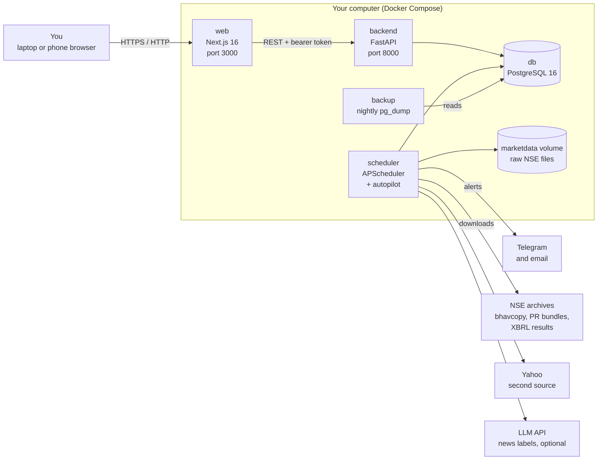
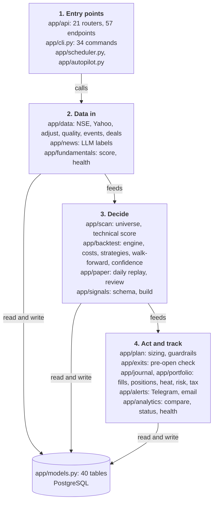
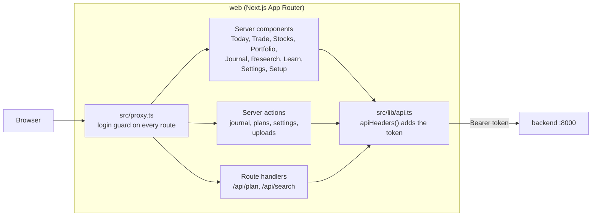
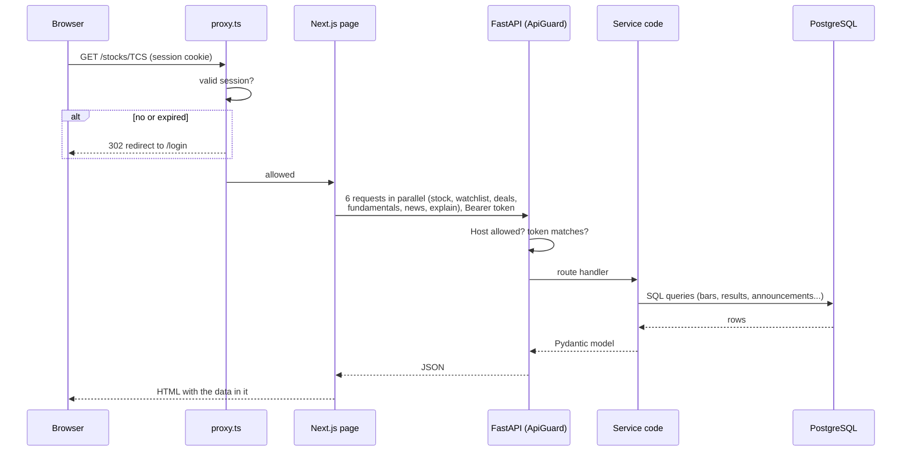
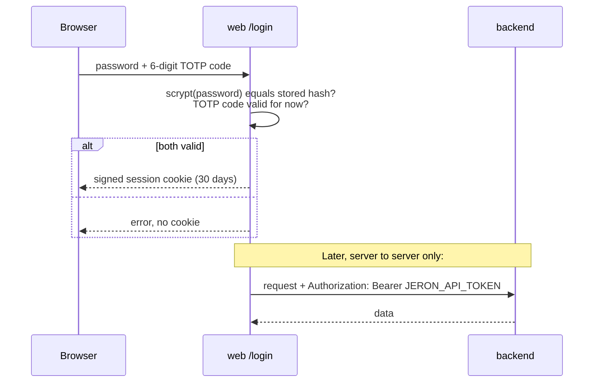
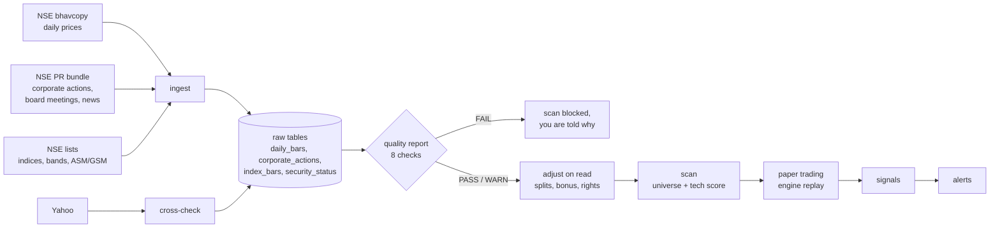
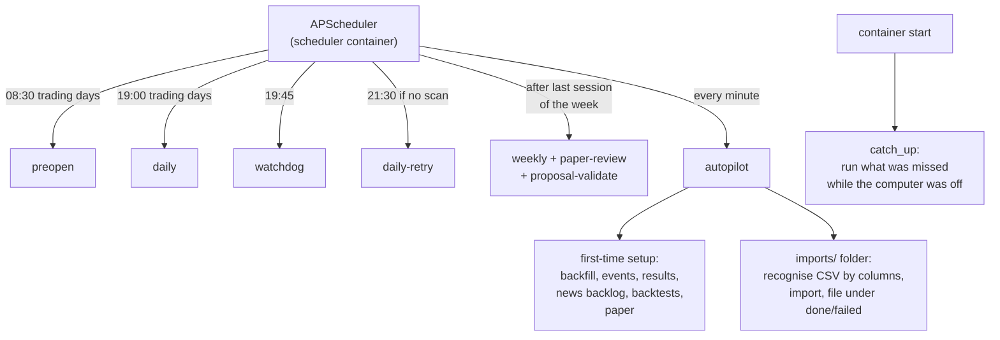

# How to read this document set

This is Part 1 of six. Each part is a document you can read on its own, and together they
cover the 12 deliverables you asked for.

| Part | Covers | Your deliverables |
|---|---|---|
| **1 (this one)** | What Jeron is, who it's for, how it works, its business rules, and the architecture **as it exists today**, with diagrams | 1, and the "existing" half of 2, 3 and 6 |
| 2 | Complete system design (HLD and LLD), API and backend, the workflow of every feature with sample requests and responses | 2, 5, 6 |
| 3 | Database design, ER diagrams, indexing, retention, backups and migrations | 4 |
| 4 | Security and reliability review, infrastructure, deployment, and scaling (1,000 to 1 million users) | 7, 8 |
| 5 | Technology review, missing features and improvements, the phased roadmap | 9, 10 |
| 6 | The beginner's learning guide and system design interview preparation | 11, 12 |

**Three labels are used throughout, so you always know what is real:**

- **[EXISTS]**: built, in the code today, with tests. Every one of these was checked in
  the source code on 1 November 2026.
- **[PROPOSED]**: a change I recommend. Not built.
- **[FUTURE]**: worth doing later, usually only if Jeron becomes a product for other people.

Part 1 describes only what exists. Recommendations start in Part 2.

---

# 1. What Jeron is

## 1.1 In one sentence

Jeron is a **personal research and decision-support tool for Indian stocks** (NSE): it
finds trade ideas with rules that have been tested honestly on ten years of history, tells
you exactly how much to buy and where to exit, tracks what you actually did, and tells
you plainly when a rule stops working.

## 1.2 The problem it solves

Most people who trade stocks lose money, and usually for the same reasons:

1. **Rules that only look good on the past.** It is easy to find a rule that would have
   made money over the last few years by trying many rules until one fits. That rule
   usually fails in the future. This is called *overfitting*: the rule learned the noise
   of the past, not a real pattern.
2. **Ignoring costs.** In India every round trip pays brokerage, STT (securities
   transaction tax), exchange charges, SEBI fees, stamp duty, GST, DP charges and
   slippage (buying a little higher and selling a little lower than the price you saw). A
   rule that makes 0.3% a trade before costs can lose money after them.
3. **No position sizing.** Buying "some shares" instead of a size based on how much you
   can afford to lose turns one bad trade into a disaster.
4. **No discipline.** Moving a stop loss, skipping the rules after a loss, buying more
   after a win.
5. **Not knowing when to stop.** A rule that worked can stop working. Without measuring,
   people find out only after large losses.

Jeron's one job, from its spec: *"prove, with honest numbers, whether its rules make
money after costs, and then help me follow those rules with discipline."*

## 1.3 Who uses it

**One person: you, the owner.** This is a deliberate design decision written into the
spec (`docs/spec.md`): Jeron is built so it *could* grow into a product (it has a
`users` table and clean module boundaries), but multi-user features, payments and public
pages are **not** to be built now. SEBI rules also require Research Analyst registration
before giving stock recommendations to other people, so a public version is a legal
decision as much as a technical one.

This single fact shapes the whole architecture. Many things that a public product would
need (load balancers, user accounts, rate limits per customer) are deliberately absent.
Part 4 explains what would change at 1,000 or 1 million users.

## 1.4 Objectives

**Primary**

1. Find out, with out-of-sample, after-cost numbers, which trading rules actually work.
2. Never let real money reach a rule before it has passed a backtest, then paper trading,
   then a small real-money stage.
3. Make following the rules easy: exact entry, stop, targets, share count and exit plan
   for every idea; alerts on the phone; an exit check every morning.
4. Show losers as clearly as winners, and stop a rule automatically when it degrades.

**Secondary**

1. A complete picture of any stock: chart, fundamentals, news, results dates, big deals.
2. A journal of real trades with the costs and tax.
3. Teaching: a Learn section explains every idea Jeron uses.
4. Run itself: a fresh install sets itself up without commands (the autopilot).

## 1.5 What it deliberately does not do

- **No automatic orders.** You place every order yourself. (Spec section 12.)
- **No short selling and no F&O.** Long-only cash equities.
- **No signals without a tested strategy behind them.**
- **No guessing when data is missing.** If a day's data fails the quality checks, the
  scan doesn't run and says why.

---

# 2. How Jeron works: one trading day

The easiest way to understand Jeron is to follow one normal day. Times are Indian
Standard Time.

| Time | What happens | Where in the code |
|---|---|---|
| **08:30** | **Pre-open check.** For every position you hold: has the stop or target been hit, are results or an ex-date coming, is the data fresh? It also re-plans yesterday's live signals on your real account as "BUYS AT THE OPEN" and sends you a Telegram message. | `app/exits/job.py`, scheduled by `app/scheduler.py` |
| 09:15 to 15:30 | The market is open. **Jeron does nothing.** It works on end-of-day data only. You place orders at your broker using the plan. | |
| **19:00** | **The daily job.** (1) Download the day's official NSE price file (the *bhavcopy*) and corporate actions; (2) index closes, price bands and surveillance lists; (3) bulk and block deals; (4) the second-source price check; (5) the data-quality report; (6) **if quality passes**, the scan: about 3,000 stocks filtered to a universe of about 950 and scored; (7) news labels; (8) paper trading: every strategy replays the day and new orders become *signals*; (9) alerts on Telegram (email as backup). | `app/data/pipeline.py`, `app/scan/job.py`, `app/paper/job.py`, `app/alerts/job.py` |
| **19:45** | **Watchdog.** If the daily summary didn't go out, it sends an alert ("Jeron didn't run"). This is a *dead-man's switch*: silence itself is treated as a failure. | `app/alerts/watchdog.py` |
| 21:30 | **Retry** the daily job, only if there is still no scan for the day (NSE is sometimes late). | `app/scheduler.py` |
| Weekend | **Weekly job.** Revalidate every strategy, retire any whose last 50 trades lost money, write the weekly summary, run the paper review. | `app/analytics/weekly.py`, `app/paper/optimize.py` |
| Any time | **You** open the web app on laptop or phone: Today, Trade, Stocks, Portfolio, Journal, Research, Learn. | `web/` |

---

# 3. Core features (all [EXISTS])

Grouped the way the app's navigation groups them.

**Data you can trust**
- Ten years of NSE daily prices (5.36 million rows), stored raw and never changed;
  adjusted prices (for splits, bonuses, rights, demergers) are computed when read.
- A second source (Yahoo) to cross-check closing prices.
- A daily data-quality report (row count, trading day, invalid rows, zero volume, stale
  prices, big moves, unexplained drops, cross-check); a FAIL blocks the scan.
- A spot-check page: raw and adjusted prices and indicators for any stock and date.

**Finding ideas**
- The daily scan: universe rules (liquidity, price, surveillance lists) and a 0 to 100
  technical score (`tech-v1`).
- Stocks page: sector heatmap and a ranked list.
- Stock page: chart, fundamentals (now including ROE, ROCE, debt, cash flow), news,
  results countdown, bulk and block deals, insider trades, an "Explain this stock" brief.

**Testing ideas (the decision-maker)**
- A daily-bar backtest engine with Indian costs, slippage, price bands and circuit days.
- Walk-forward testing with a final 12 months held back, reported out-of-sample only.
- Seven pass/fail gates (spec section 6) plus an evidence-strength rating (decision 0018).
- 15 strategy versions and one combined book registered; 9 run on 1 November 2026, 4 passed.

**Acting on ideas**
- Signals with every field required: entry zone, stop, two targets, share count, risk,
  exit plan, invalidation, event risk, backtest stats.
- Trade plans with the risk rules enforced (position size, heat, sector, drawdown brake,
  loss limits, kill switch).
- Telegram alerts with buttons ("I bought it", "skip because...").

**Tracking and reviewing**
- Paper trading: one account per strategy version, replayed every day.
- Journal: fills typed in or imported from Zerodha's tradebook CSV.
- Portfolio: open risk, heat, sector exposure, tax timing, a "bad days" stress card.
- Backtest vs paper vs real comparison, with likely causes when they diverge.
- Strategy status: Research, Paper, Small capital, Approved, Retired.

**Running itself**
- Scheduler, autopilot, nightly verified backups, kill switch, watchdog, Setup page.

---

# 4. The major business rules

These are the rules the code enforces. Each one is in the spec and has a test.

**Universe (who can be bought), spec section 2**
- Nifty 500 plus NSE mainboard stocks with a 20-day median turnover of at least ₹5 crore
  and a price of at least ₹20.
- Excluded: surveillance lists (ASM/GSM), trade-to-trade segment, SME platform, suspended.
- Your order may be at most 1% of the stock's 20-day average volume.

**A valid signal, spec section 4**
- Every field present, or the signal is rejected (a Pydantic schema enforces it).
- Reward to risk at the second target at least 2.0 *after* costs and slippage.
- Stop distance at least 1 x ATR and at most 12% (swing) or 20% (positional).
- Signals are never changed after creation; a change is a new version.

**Risk manager, spec section 5 (non-negotiable)**
- Shares = floor((capital x risk%) / (entry - stop)), capped at 20% of capital per
  position and 1% of average volume.
- Risk per trade 0.5 to 2% (default 1%); halved in a risk-off market.
- At most 5 swing, 8 positional, 15 invest positions; sector at most 30% of capital.
- Total open risk ("heat") warns at 5% and blocks at 6%.
- Account down 10% from its peak: risk halved and new trades must be paper first with a
  written note. Down 15%: no new entries.
- Stop to breakeven at +1R, half sold at the first target, the rest trailed by 2 x ATR,
  and a time stop.

(**R** is the amount risked on a trade: entry minus stop, times shares. A trade that
makes twice what it risked is +2R. Using R lets you compare trades of any size.)

**When a strategy may be used, spec sections 6 and 7**
- *Live-eligible* only if, out-of-sample and after costs: expectancy above 0.15R, profit
  factor at least 1.3, max drawdown at most 20%, at least 100 trades, positive in at
  least 2 of 3 market regimes, a better Sharpe ratio than buy-and-hold Nifty 500, and a
  positive final 12 months.
- Then paper trading for at least 3 months and 30 trades; then 10 to 20% of capital for
  3 months; only then full capital.
- Retired automatically if its last 50 trades lose money or its drawdown passes 1.5 times
  the backtest's.

---

# 5. The architecture today

## 5.1 The containers

Jeron runs as five Docker containers on one computer, started by `docker compose up`.

**What each one does, and why it exists**

| Container | What it does | Why it is separate |
|---|---|---|
| **web** | The user interface. Server-side rendered pages; it calls the backend from the server, so your browser never talks to the API directly. | Different language (TypeScript) and job (presentation). |
| **backend** | The API: reads and a few writes (journal, plans, settings, watchlist). Every request needs the API token. | Must answer quickly and never be blocked by a long job. |
| **scheduler** | Runs the jobs: daily, pre-open, watchdog, weekly, the autopilot. Each job runs as its own process (the CLI). | Jobs can take minutes to hours (a backtest, a backfill) and must not slow the web app. |
| **db** | PostgreSQL: all state. | The one source of truth. |
| **backup** | A nightly `pg_dump`, kept only if `pg_restore` can read it; a weekly test restore. | Backups must not depend on the app being healthy. |

**Data flow in plain words:** NSE's files flow *in* through the scheduler into the
database. Your requests flow from the browser to `web`, from `web` to `backend`, from
`backend` to the database, and back. Alerts flow *out* from the scheduler to Telegram.
The backend and the scheduler share the same code (`backend/app`) but run as two
processes.

## 5.2 The backend's modules

The backend is one Python codebase organised by business area. A rule runs through it:
**pure modules have no database imports**. The maths (indicators, scoring, the engine,
risk rules) is in pure functions you can test with plain inputs; separate `job.py` or
`service.py` files load from and save to the database.

**Arrows read as "uses".** The most important chain is `paper -> backtest -> scan`:
paper trading *is* the backtest engine replayed each day, so paper results and backtest
results come from identical code. That is a strong design choice: a difference between
backtest and paper can't come from two implementations disagreeing.

## 5.3 The web app

- **30 pages** (for example `/`, `/trade/[section]`, `/stocks/[symbol]`, `/journal`,
  `/research/strategies`, `/learn/[slug]`).
- Pages are **server components**: the page's HTML is built on the server with the data
  already in it.
- **Writes** (journal fills, trade plans, settings, file uploads) go through **server
  actions**, so the browser never needs the API token.
- Two **route handlers** serve the live parts: the trade-plan calculator and the search
  box.

## 5.4 A request from start to finish

What happens when you open a stock page, for example `/stocks/TCS`:

1. The browser asks for the page and sends its session cookie.
2. `proxy.ts` checks the login. No valid session: redirect to `/login`.
3. The page's server code asks the backend for six things at once (`Promise.all`).
4. `ApiGuard` middleware checks the Host header (against DNS rebinding) and the bearer
   token (constant-time comparison). Fail: 400 or 401.
5. Each route calls service code, which queries PostgreSQL.
6. The JSON is validated by Pydantic models on the way out.
7. The page renders HTML with the data and sends it to the browser.

There is **no cache layer** today. Every page view queries the database. For one user
that is fast enough; Part 4 covers when that changes.

## 5.5 Login and API protection

- **Two factors:** something you know (password, stored only as a *scrypt hash*, a slow
  one-way scramble so a stolen hash is hard to reverse) and something you have (the
  6-digit code from an authenticator app, *TOTP*).
- **The API is never exposed to the browser.** It listens on 127.0.0.1 only and needs a
  bearer token that only the web server has.
- Changing the password or the TOTP key logs out every device.

## 5.6 The data pipeline

Two rules make this pipeline trustworthy:

1. **Raw data is never changed.** If NSE says a stock closed at ₹1,000 before a 1:2
   split, that ₹1,000 stays in the database forever. The adjusted ₹500 is computed when
   needed. So a mistake in the adjustment code can be fixed and re-run; the original
   facts are never lost.
2. **Point in time.** Every fact carries the date it became known (a results filing's
   publication time, the day a stock joined an index). A backtest on 2020 only sees what
   was known in 2020. Without this, a backtest quietly uses the future and looks far
   better than it is (*look-ahead bias*).

## 5.7 Background jobs

Each job runs as a **separate process** (`python -m app.cli <command>`). If a job
crashes it can't take the scheduler down with it, and the same commands can be run by
hand. The market-data jobs share a lock (`market_lock`) so two can't write the same data
at once.

---

# 6. Dependencies between modules

What depends on what, as a chain from data to decision:

1. **Data** (`app/data`) depends on nothing inside Jeron; everything depends on it.
2. **Scan** needs adjusted prices, the security lists and the quality report.
3. **Backtest** needs the scan's universe and score for every day (`market.py` rebuilds
   them in memory), plus results dates, fundamentals and news for the strategies that
   use them.
4. **Paper trading** needs a *passed* backtest run for each strategy version; without one
   it opens no account.
5. **Signals** come only from paper trading's new orders.
6. **Alerts** send signals, the daily summary and watchlist hits.
7. **Trade plans** reuse the engine's own sizing function, so a plan and the backtest
   size positions identically.
8. **Journal, portfolio, exits** depend on your fills plus prices.
9. **Analytics** compares backtest, paper and journal, and changes a strategy's status.

If **data** is missing, everything downstream stops and says so. That is intended.

---

# 7. Jeron in numbers (1 November 2026, the session's database)

| Item | Count |
|---|---|
| Stocks known (instruments) | 4,045 |
| Daily price rows (NSE), 2016-01-01 to 2026-10-30 | 5,362,250 |
| Corporate actions | 18,053 |
| Index closes | 260,625 |
| Price-band and surveillance rows | 3,561,726 |
| Board meetings | 97,767 |
| Company announcements | 906,432 |
| Quarterly results filings | 25,128 (to December 2024) |
| Data-quality reports | 2,683 (all WARN, none FAIL) |
| Backtest runs / trades | 9 / 3,857 |
| Paper accounts | 8 |
| Database tables | 40 |
| API endpoints | 57 in 21 routers |
| Web pages | 30 |
| Backend tests | 734 (all passing, database tests included) |

**Information I don't have:** how you actually run it day to day (laptop always on or
not), how much capital you intend to use, and whether you plan to open Kite Connect.
These change some recommendations in Parts 4 and 5.

---

# 8. Key terms (in simple words)

| Term | Meaning |
|---|---|
| **Bhavcopy** | NSE's official end-of-day file: every stock's open, high, low, close and volume. |
| **Corporate action** | A company event that changes the share count or price basis: split, bonus, rights issue, dividend, demerger. |
| **Adjusted price** | Past prices restated so a split doesn't look like a crash. |
| **Universe** | The stocks allowed to be traded on a given day. |
| **ATR** | Average True Range: a stock's typical daily move in rupees. Used to set stops. |
| **R** | The rupees risked on a trade (entry minus stop, times shares). Results are measured in R. |
| **Expectancy** | The average result per trade, in R. Above 0 means the rule makes money on average. |
| **Profit factor** | Total gains divided by total losses. Above 1 means it makes money. |
| **Drawdown** | A fall from the account's previous peak. |
| **Sharpe ratio** | Return per unit of risk. Higher is better. |
| **Backtest** | Running a rule on past data as if trading it. |
| **Walk-forward** | Choose a rule's settings on one period, test them on the next, unseen period; repeat. |
| **Out-of-sample** | Data the rule's settings were *not* chosen on. Only these numbers count. |
| **Holdout** | The final 12 months, kept untouched until the very end. |
| **Overfitting** | A rule that learned the past's noise, not a real pattern. |
| **Deflated Sharpe** | A Sharpe ratio corrected for how many rules were tried, to see whether the best one could be luck. |
| **Paper trading** | Trading with pretend money, live, to check the backtest. |
| **Heat** | Total risk of all open positions, as a % of capital. |
| **Point in time** | Using only what was known on each past day. |
| **Pure function** | Code that only computes: same inputs, same output, no database or network. |

---

# 9. What comes next

**Part 2** designs the complete system: functional and non-functional requirements,
monolith vs microservices (and why a modular monolith is right here), the high-level and
low-level design, every API with sample requests and responses, and the step-by-step
workflow of every major feature. It also marks every place where today's design should
change, labelled [PROPOSED].
