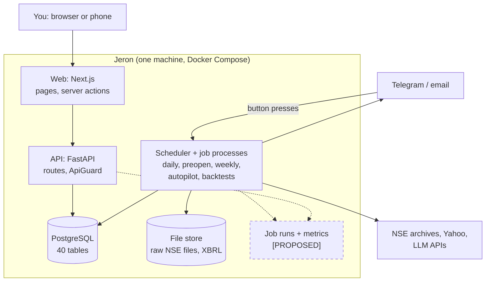
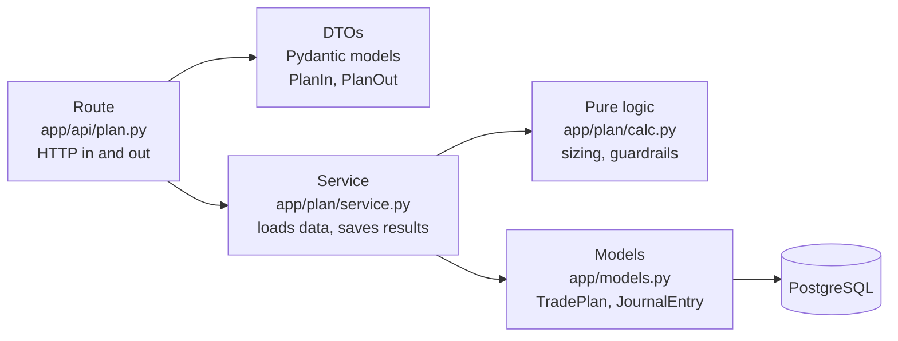
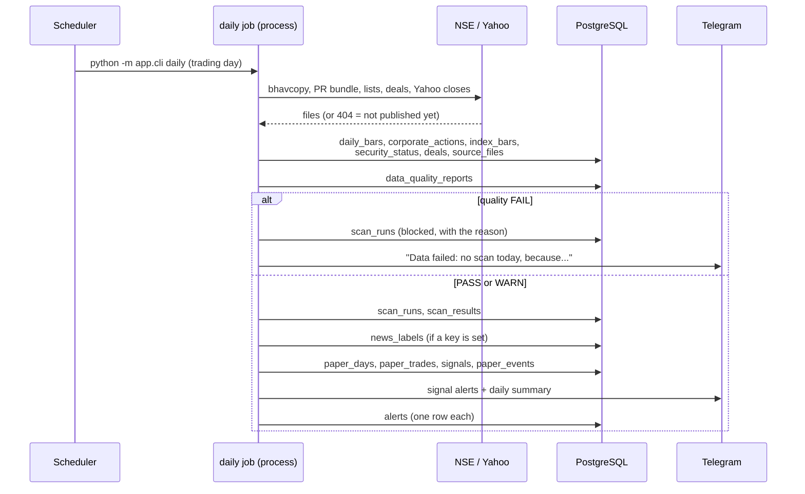
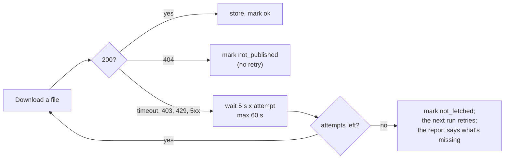

# About this part

Part 1 described Jeron as it is. This part designs the complete system: the
requirements, the architecture style and why, the high-level and low-level design, the API
and backend conventions, and the step-by-step workflow of every major feature with real
requests and responses captured from Jeron's API.

Labels, as in Part 1: **[EXISTS]** is built and checked in the code; **[PROPOSED]** is a
change I recommend; **[FUTURE]** is for later, usually only if Jeron serves other people.

---

# 1. Requirements

A *requirement* is something the system must do (functional) or a quality it must have
(non-functional). Writing them down first stops you from building features nobody needs
and from forgetting the qualities that matter most.

## 1.1 Functional requirements

| # | The system must... | Status |
|---|---|---|
| F1 | Download NSE's daily prices, corporate actions, index closes, security lists, board meetings, announcements and deals | [EXISTS] |
| F2 | Keep raw prices unchanged and compute adjusted prices on read | [EXISTS] |
| F3 | Cross-check closes against a second source and produce a daily quality report; block the scan on FAIL | [EXISTS], cross-check run on 1 Nov 2026 for the first time |
| F4 | Build the day's universe and technical score | [EXISTS] |
| F5 | Backtest any registered strategy walk-forward, after costs, with a 12-month holdout, and save the run | [EXISTS] |
| F6 | Paper-trade every passing strategy daily and turn new orders into complete signals | [EXISTS] |
| F7 | Alert signals, a daily summary, watchlist hits and the pre-open check on Telegram, email as backup | [EXISTS] |
| F8 | Size a trade and enforce the risk rules before a plan is saved | [EXISTS] |
| F9 | Record fills by hand or from Zerodha's tradebook, without duplicates | [EXISTS] |
| F10 | Show portfolio heat, risk, sector exposure and tax timing | [EXISTS] |
| F11 | Compare backtest, paper and real results and change a strategy's status | [EXISTS] |
| F12 | Show a stock's chart, fundamentals, balance sheet, news, results dates and deals | [EXISTS] |
| F13 | Set itself up and import dropped files without commands | [EXISTS] |
| F14 | Stop every new buy with one command (kill switch) | [EXISTS] |
| F15 | Combine the three brains (technical, fundamental, news) into one score per tier | **Missing.** Spec section 3; [PROPOSED] in Part 5 |
| F16 | Live prices from a broker (Kite Connect) | **Missing.** Needs a paid account; your decision |
| F17 | Promoter holding and pledges; FII/DII flows | **Missing.** Needs new data sources |

## 1.2 Non-functional requirements

| Quality | Target | Why it matters here |
|---|---|---|
| **Correctness** | No look-ahead; raw data never changed; every money value a `Decimal` | A backtest that cheats is worse than none: it gives false confidence with real money |
| **Reproducibility** | Every backtest run records its code hash, settings hash and data fingerprint | So a result can be re-created and audited months later |
| **Timeliness** | Daily job done by about 19:30 IST; pre-open check by 08:35 | Signals are useless after the open |
| **Availability** | High during two short windows (08:30 and 19:00), low otherwise | A single-user tool doesn't need 99.99%; it needs the two jobs not to be missed. The watchdog and `catch_up` cover this |
| **Performance** | Scan under 5 minutes (spec); a page under 1 second; a backtest in minutes | Measured 1 Nov 2026: scan 21.7 s for 3,004 stocks |
| **Security** | Nothing reachable from the internet by default; two-factor login; token-protected API | It holds your positions and, later, a broker token |
| **Recoverability** | A verified backup every night; a test restore every week | Losing years of journal and paper history can't be undone |
| **Maintainability** | Pure logic separate from database code; every rule tested | One person maintains it |
| **Cost** | Runs free on your own computer; the LLM spend capped monthly | Personal tool |

---

# 2. Choosing the architecture style

## 2.1 The options

**What is it?** An *architecture style* is the big decision about how the code is split
into deployable pieces.

- **Monolith:** one application, one codebase, deployed together.
- **Modular monolith:** one deployable application, but internally split into modules with
  clear boundaries (Jeron's style).
- **Microservices:** many small applications, each with its own database, talking over the
  network.

## 2.2 The evaluation

| Concern | Modular monolith (Jeron today) | Microservices |
|---|---|---|
| Team size it suits | 1 to about 20 developers | Several independent teams |
| Deploying | One `docker compose up` | Many services, versions, network config |
| A call between modules | A function call: microseconds, can't fail on the network | A network call: milliseconds, can time out, needs retries |
| Data consistency | One database, one transaction | Each service has its own data; consistency needs sagas or events |
| Testing a whole flow | One process, one test database | Many services to start, contract tests |
| Scaling parts independently | Not needed: Jeron's heavy work (backtests) already runs in separate processes | The main benefit |
| Cost | One small machine | More machines, more operations work |

**Decision: keep the modular monolith. [EXISTS]** Microservices solve problems Jeron
doesn't have: many teams, parts that must scale separately under heavy traffic. They would
add network failures, distributed data and operations work to a one-person project.

**Common mistake:** splitting into microservices early "for scalability". Most systems
that do this end up with a *distributed monolith*: all the network cost of microservices,
and still every service has to be deployed together.

**Where Jeron already separates work**, and why that's enough:

1. The **web** app is separate (different language and job).
2. **Long jobs** run in the **scheduler** container, each as its own process, so a
   three-hour backtest can't slow a page.
3. The **backup** is separate so it works even if the app is broken.

If Jeron ever became a product with thousands of users, the first split would be the
*job workers* (Part 4), not the business modules.

---

# 3. High-level design (HLD)

The HLD shows the big pieces and how they talk. Blue boxes exist today; the dashed ones
are [PROPOSED] additions explained below.



**Request path (synchronous):** browser to web to API to database and back. Used for
everything you look at and for the few writes you make.

**Job path (asynchronous):** the scheduler starts job processes on a timetable; they read
from outside sources, write to the database and send alerts. Nothing you do in the
browser waits for them.

**Why two paths?** A web request must answer in under a second. A backfill can take
hours. Mixing them would make the app freeze whenever a job ran.

## 3.1 Communication between components

| From | To | How | Why that way |
|---|---|---|---|
| Browser | Web | HTTP, session cookie | Standard; the cookie carries the login |
| Web | API | HTTP JSON, bearer token, server side only | The token never reaches the browser |
| API, jobs | PostgreSQL | SQLAlchemy over TCP | One source of truth |
| Scheduler | Job | Starts `python -m app.cli <job>` as a process | Crash isolation; the same command works by hand |
| Jobs | NSE, Yahoo | HTTPS through `Fetcher` (rate limit, retries) | NSE blocks bursts |
| Jobs | Telegram | HTTPS Bot API | Phone alerts |
| Telegram | Jeron | **Polling** every minute (`app/alerts/bot.py`) | No public URL needed: Jeron calls Telegram, Telegram never calls Jeron |

**No message queue or event bus. [EXISTS]** Jobs run in a fixed order inside one
command (the daily job calls ingest, then quality, then scan, then paper, then alerts).
A queue such as RabbitMQ or Kafka is for many producers and consumers at high volume; Jeron
has one producer and one schedule.

## 3.2 Event-driven where it helps

*Event-driven* means components react to things that happened ("the scan finished")
instead of being called directly. Jeron uses the idea in three small places today:

1. **Append-only event tables** [EXISTS]: `paper_events` (every paper order, fill,
   exit), `strategy_status_changes`, `setting_changes` (including the kill switch). Rows
   are only ever added, so the history explains itself.
2. **The imports folder** [EXISTS]: a dropped file is an event; the autopilot reacts.
3. **Telegram button presses** [EXISTS], read every minute and stored once each.

**[PROPOSED] A `job_runs` table** as the one event log for jobs: each job writes a row
when it starts and finishes (status, duration, counts, error). The watchdog, the Setup
page and a health check all read it instead of each inferring "did it run?" in its own
way. This is the simplest useful step toward observability, and it needs no new
infrastructure.

---

# 4. Low-level design (LLD)

The LLD shows how code inside a module is organised.

## 4.1 The layers inside every module [EXISTS]



| Layer | Job | Example | What breaks without it |
|---|---|---|---|
| **Route** | Turn HTTP into a function call and back; status codes | `@router.post("/plans")` | Business code would be full of HTTP details |
| **DTO** (data transfer object) | Validate input and shape output | `PlanIn` rejects a stop of 0 or a 3,000-character reason | Bad data reaches the database |
| **Service** | Load what the logic needs, call it, save the result, commit | `app/plan/service.py` | Logic would query the database itself and become untestable |
| **Pure logic** | The actual rules: no database, no network, no clock | `position_size`, `guardrails` | Rules could only be tested with a database |
| **Models** | Table definitions (SQLAlchemy ORM) | `TradePlan` | |

This is close to a "hexagonal" or "ports and adapters" design without the ceremony: the
rules sit in the middle and know nothing about how they are called or stored.

**Common mistake:** putting the business rule in the route ("if heat > 6: return 400").
Then the same rule must be rewritten for the CLI, the Telegram bot and the backtest, and
the copies drift apart. Jeron's guardrails live once in `calc.py` and every caller uses
them; the backtest engine and the trade plan share the same `position_size`.

## 4.2 One rule, one place: examples [EXISTS]

| Rule | The single place it lives | Used by |
|---|---|---|
| Position size | `app/backtest/engine.py` `position_size` | backtest, paper, trade plan, signals |
| Exit rules (stop, breakeven, T1, trail, time stop) | the engine; `app/exits/rules.py` replays them for one position, checked against the engine in tests | backtest, paper, pre-open check |
| Tier targets and trail | `TIERS` in `strategies.py`, applied by `simulate` over the stored rules | every simulation |
| Costs | `app/backtest/costs.py` | backtest, plan, signals, journal |

A subtle point worth knowing: a paper account stores its `PortfolioRules`, and those
show the default `t1_r: 2.0` even for the invest tier. They are not what it trades:
`simulate` applies the tier's own targets (`TIERS[tier].apply(rules)`) every time, so the
invest account books half at +3R and trails at 4 x ATR. It reads like a bug; it isn't.
**[PROPOSED]** store the applied rules, so what you read is what trades.

## 4.3 Database sessions and transactions [EXISTS]

- **API:** one SQLAlchemy session per request (`get_session` in `app/db.py`, a FastAPI
  dependency). The service commits once at the end, so a request either saves everything
  or nothing.
- **Jobs:** one session per job; long jobs commit in batches (every 50 filings, every
  500 rows) so a crash loses at most one batch, and the job can resume.
- **Idempotent writes:** many tables have a unique key, and inserts use
  `ON CONFLICT DO NOTHING`, so re-running a job never doubles data (section 5.6).

## 4.4 Concurrency [EXISTS, with a gap]

The market-data jobs share `market_lock`, so the autopilot and the scheduler's jobs don't
write the same data at once. **Gap:** it is a `threading.Lock` inside the scheduler
process. A command you run by hand (`docker compose exec backend python -m app.cli
daily`) doesn't see it and can overlap the scheduled job.

**[PROPOSED]** Use a PostgreSQL *advisory lock* (`pg_try_advisory_lock(<job id>)`) at the
start of each market job. It works across processes and containers, is released
automatically if the process dies, and needs no new software.

---

# 5. API architecture

## 5.1 Shape of the API [EXISTS]

- **REST-style JSON over HTTP**, 57 endpoints in 21 routers, grouped by business area.
- **Reads are GETs**; the few writes are POST, PUT or DELETE (plans, journal entries and
  fills, settings, watchlist, signal decisions, imports).
- **Validation** by Pydantic: a bad request gets `422` with the field and the reason.
- **Errors** are `{"detail": "..."}` in plain words, as FastAPI does by default.
- **Documentation** is generated automatically at `/docs` (OpenAPI).

| Area | Endpoints (examples) |
|---|---|
| Health | `GET /health` (open; everything else needs the token) |
| Data | `GET /data/quality`, `GET /data/quality/{trade_date}`, `GET /data/spot-check` |
| Scan and stocks | `GET /scan/latest`, `GET /stocks/ranked`, `GET /stocks/search`, `GET /stocks/{symbol}` |
| Stock detail | `/stocks/{symbol}/fundamentals`, `/news`, `/deals`, `/explain`, `POST .../explain/narrate`, `GET /stocks/compare` |
| Backtests | `GET /backtests/runs`, `/backtests/{run_id}`, `/backtests/{run_id}/trades` |
| Paper | `GET /paper/accounts`, `/paper/accounts/{id}`, `/review`, `/audit`, `GET /paper/proposals` |
| Plans | `GET /plan/{symbol}` (calculator), `POST /plans`, `GET /plans`, `GET /plans/{plan_id}` |
| Journal | `GET /journal`, `GET/PUT /journal/{entry_id}`, `POST /journal/{entry_id}/fills`, `DELETE /journal/fills/{fill_id}`, `POST /journal/import` |
| Portfolio and market | `GET /portfolio`, `/portfolio/equity`, `/portfolio/risk`, `GET /market/mood` |
| Strategy status | `GET /strategies`, `/strategies/registry`, `GET /sections` |
| Analytics | `GET /analytics/compare`, `GET /analytics/weekly` |
| Settings and setup | `GET/PUT /settings`, `GET /setup`, `GET /imports`, `PUT /imports/{name}` |

## 5.2 Middleware [EXISTS]

*Middleware* is code that runs on every request before the route. Jeron has two:

1. **`ApiGuard`** (`app/api/security.py`): rejects an unknown `Host` header (400, against
   DNS rebinding) and a missing or wrong bearer token (401). The token is compared in
   constant time (`hmac.compare_digest`), so an attacker can't guess it one character at
   a time from response times.
2. **CORS** allowing only `GET` from `JERON_CORS_ORIGINS`. (The browser never calls the
   API directly, so this is a second line of defence.)

## 5.3 Pagination and filtering [EXISTS, partly]

Long lists take `limit` and `offset` with bounds, for example
`GET /stocks/ranked?offset=0&limit=50` (limit 1 to 500), `GET /backtests/runs?limit=100`,
`GET /stocks/{symbol}/news?limit=40`. Shorter lists (paper accounts, strategies) return
everything, which is fine at their sizes (under 100 items).

## 5.4 Versioning [PROPOSED]

There is no version in the paths. With one client (the web app, deployed together with the
API) that is reasonable: both change in the same commit. **[PROPOSED] when a second client
appears** (a phone app, a public API): serve the same routers under `/v1` as well, and
change a response's shape only in `/v2`.

## 5.5 Rate limiting [PROPOSED, only when exposed]

None today, and none needed while the API listens on 127.0.0.1 behind a token. If the web
app is ever put on the internet (a cloud VM), the **login** needs rate limiting first:
after 5 failed attempts from an address, wait (for example 15 minutes). That stops
password and TOTP guessing. Part 4 has the details.

## 5.6 Idempotency [EXISTS]

*Idempotent* means doing it twice has the same effect as doing it once. It matters
because jobs are retried and buttons get pressed twice.

| What | How it's made idempotent |
|---|---|
| Alerts | `alerts.key` is unique: each alert is stored once, so a re-run never sends twice |
| Telegram presses | `bot_updates` stores each update id once |
| Tradebook import | `journal_fills.broker_trade_id` is unique: re-importing adds nothing |
| Signals | unique (account, signal date, ticker, version): a re-run of paper trading doesn't duplicate |
| Prices, meetings, deals, filings | unique keys plus `ON CONFLICT DO NOTHING` |
| Journal entry per signal | `journal_entries.signal_id` is unique |

**[PROPOSED]** `POST /plans` and `POST /journal/{id}/fills` have no idempotency key: a
double click on a slow connection could save two plans or two fills. Accept an
`Idempotency-Key` header (a random id the form generates once) and store it with a
unique constraint.

## 5.7 Retries and timeouts [EXISTS]

`Fetcher` (`app/data/http.py`), used for every NSE and Yahoo download:

- **Timeout** 30 seconds per request.
- **Rate limit:** waits its turn (about one request a second for NSE).
- **Retries** on network errors and on the retryable statuses, waiting 5 s, 10 s, 15 s...
  up to 60 s (*linear back-off*).
- **404** means "not published" (a holiday, a file NSE didn't make): a distinct error, not
  retried, so the job records it and moves on.
- **Other statuses** stop with a clear error.

Telegram calls time out after 20 s and DeepSeek after 60 s. **[PROPOSED]** add *jitter*
(a small random extra wait) to the back-off, so several jobs don't retry in lockstep, and
give every external client an explicit timeout.

## 5.8 Caching [EXISTS: almost none; PROPOSED: one targeted cache]

**What is a cache?** A copy of a result kept close by, so the next request doesn't redo
the work.

Today Jeron caches only its settings and a few constant lookups in memory. Every page view
queries PostgreSQL. With one user and indexes, that's fast enough.

**[PROPOSED] cache by data version, not by time.** Most of Jeron's data changes **once a
day**, when the daily job finishes. So the right cache key is "the latest trade date":
`/market/mood`, `/stocks/ranked`, `/sections` and the heatmap can be computed once per
trade date and served from memory until the next daily job. No Redis needed: an
in-process dictionary keyed by `(endpoint, params, latest_trade_date)`.

**Common mistake:** caching with a fixed expiry ("5 minutes"). The user then sees stale
data right after the daily job, or the cache refreshes 288 times a day for data that
changed once.

---

# 6. Workflows of every major feature

Each workflow answers: the trigger, who receives it, the APIs, the logic, the tables, the
cache, what happens on failure, and the response.

## 6.1 The daily job (19:00)



| Question | Answer |
|---|---|
| Trigger | APScheduler at 19:00 IST on trading days (`app/scheduler.py`), or `catch_up` at start-up if missed |
| Receives | `app/cli.py daily`, as its own process |
| Logic | `pipeline.daily_update`, then `run_scan`, `run_daily_news`, `run_paper`, `run_alerts` |
| Tables written | `daily_bars`, `corporate_actions`, `index_bars`, `security_status`, `deals`, `source_files`, `data_quality_reports`, `scan_runs`, `scan_results`, `news_labels`, `paper_days`, `paper_trades`, `signals`, `paper_events`, `alerts` |
| Cache | None |
| On failure | NSE late (404): recorded as not published; the 21:30 retry runs if there's no scan. Quality FAIL: scan blocked, you're told why. Process crash: the 19:45 watchdog alerts you. All writes are idempotent, so a re-run is safe |
| Output | Telegram messages; new rows the web app shows |

## 6.2 The pre-open check (08:30)

| Question | Answer |
|---|---|
| Trigger | Scheduler, 08:30 IST, trading days |
| Logic | `app/exits/job.py`: for each open journal position, apply the engine's exit rules (`app/exits/rules.py`) to the last close; list results and ex-dates ahead; refuse to act on stale data; re-plan live signals valid today on the real account ("BUYS AT THE OPEN"); add tax-timing notes and the backup check |
| Tables read | `journal_entries`, `journal_fills`, `daily_bars`, `corporate_actions`, `board_meetings`, `signals`, `setting_changes` (halt) |
| Tables written | `alerts` |
| On failure | Stale prices: says "data is stale, check by hand" rather than giving a wrong exit |
| Output | A Telegram message. The real one for Monday 2 November 2026 on this session's database (no journal positions yet): |

```text
Jeron pre-open check, Mon 2 Nov 2026

No open positions in the journal.

Journal: http://localhost:3000/journal
```

With positions, the message groups them under the code's own headings (`app/exits/job.py`
`preopen_message`): **SELL ALL at the open**, **SELL HALF**, **HOLD**, then **STOPS AT
THE BROKER** (the GTT stop to keep), **CHECK BY HAND** (anything it can't decide),
**BUYS AT THE OPEN**, **TAX**, **EVENTS**, **CASH**, **CALENDAR** and **BACKUP**. If the
day's prices aren't loaded it says so and gives no actions at all.

## 6.3 Opening a stock page

Covered step by step in Part 1, section 5.4. Six parallel GETs, no cache, about 100 to
300 ms on a laptop.

## 6.4 Planning a trade

**Trigger:** you open `/plan/TCS` or press "Plan" on a signal.

1. The page calls `GET /plan/TCS`. The service loads the stock (last close, ATR, average
   volume, score), the market mood, results dates and ex-dates, your capital and open
   risk, and computes a default plan with the engine's sizing.
2. As you change entry or stop, the form recalculates through the read-only route handler
   `/api/plan`, which calls the same endpoint with query parameters.
3. You tick the checklist and save: `POST /plans`.
4. `guardrails` in `app/plan/calc.py` checks the kill switch, heat, positions per tier,
   sector, the drawdown brake, the daily and weekly loss limits, the weekly entry cap,
   and (10% below the peak) the paper-first rule.
5. Saved: a `trade_plans` row (never changed; a new plan supersedes). Refused: `400` with
   the reason.

A real calculation (1 Nov 2026, scratch database, ₹10 lakh capital, market in "defend"
mode so risk is halved to 0.5%):

```http
GET /plan/TCS?entry=2502.6&stop=2359.05&tier=swing
```

```json
{
  "entry": "2502.6", "stop": "2359.05", "tier": "swing",
  "shares": 34, "sized_by": "risk per trade",
  "risk_per_share": "143.55", "risk_amount": "4880.70",
  "position_value": "85088.40", "position_pct": "8.51",
  "target1": "2789.70", "target2": "2933.25",
  "reward_risk_t1": "1.83", "reward_risk_t2": "2.76",
  "round_trip_costs": "304.71", "stop_distance_pct": "5.74", "stop_atr": "2.00",
  "heat_before_pct": "0.00", "heat_after_pct": "0.49"
}
```

Note the money values are **strings**: they are `Decimal`s, and JSON numbers would turn
them into floating point and lose exactness. Reward to risk at T2 is 2.76 *after* the
₹304.71 round-trip costs, so it passes the spec's 2.0 minimum.

A real refusal:

```http
POST /plans
{"ticker":"TCS","tier":"swing","entry":"2502.60","stop":"2359.05",
 "reason":"Sample plan","checklist":["trend","event","size","stop","exit"]}
```

```json
{"detail": "Tick every checklist item: Market mood allows a buy; No results within the blackout window; I will record the fill today"}
```

## 6.5 Recording a trade

| Path | Steps | Duplicate protection |
|---|---|---|
| By hand | Journal page, server action, `POST /journal/{entry_id}/fills` | [PROPOSED] idempotency key |
| Zerodha tradebook | Upload on Setup or drop in `imports/`; recognised by its columns; `app/journal/tradebook.py` reads it, `importer.py` makes fills | `broker_trade_id` unique |
| Telegram | "I bought it", then type the fill price; `app/alerts/bot.py` reads it within a minute | `bot_updates` |

Tables: `journal_entries`, `journal_fills`. Every reader of fills goes through
`journal/service.restated`, which restates old fills through later splits and bonuses, so
a sale after a split matches the right share count.

## 6.6 Running a backtest

**Trigger:** `python -m app.cli backtest --strategy fip-momentum`, or the autopilot for any
version without a run.

1. `load_inputs` reads prices, actions, lists, results, news and fundamentals.
2. `build_market` builds aligned arrays (stocks x days): adjusted prices, indicators,
   universe, scores and ranks. About 3 minutes for 2,930 stocks x 2,683 days.
3. `walkforward.evaluate`: for each yearly fold, pick the grid point with the best
   training Sharpe, trade the next year with it; then the holdout.
4. The confidence engine reruns with doubled slippage, 1.5x charges and late entries, and
   bootstraps the intervals.
5. Saved: `backtest_runs` (summary, equity), `backtest_trades`, `backtest_variants`. Runs
   are **never overwritten**; a new run is a new row.

Failure: missing inputs, so the strategy is skipped with the reason ("needs the results
calendar"). Output: the console summary and the Backtests pages.

## 6.7 Paper trading and signals

Paper trading **replays the engine** from the account's start to today, every day. New
orders on the last day become signals (`app/signals/build.py`), checked against the
schema (every field required) and stored once. A signal is *research only* if its strategy
failed the gates or Jeron is stopped. Tables: `paper_accounts`, `paper_days`,
`paper_trades`, `signals`, `paper_events`.

Why replay rather than keep a running state? Replaying from the start each day means the
paper account can never drift from the engine's rules: it *is* the engine. The cost is a
few seconds of computing.

## 6.8 Weekly revalidation

After the week's last session: per strategy, the rolling 50-trade expectancy and drawdown
against the backtest; retire a failing version (`strategy_status_changes`); the weekly
summary; the paper review writes `strategy_proposals` (never applied automatically); and
`proposal-validate` backtests up to two proposals.

## 6.9 The autopilot and imports

Every minute: if setup isn't done, start the next step (history, first daily run,
announcements, the bundled results, the news backlog, backtests of untested versions,
paper). And check `imports/`: identify each file by its columns (tradebook, results CSV,
deals, board meetings, ASM list), import it, and move it to `imports/done` or
`imports/failed` with a log. `GET /setup` reports progress.

## 6.10 The kill switch

`python -m app.cli stop-all --reason "..."` adds a `setting_changes` row (key `halt`).
From then on: no signal or watchlist alerts; new signals are research only; the trade
plan refuses every buy; the summary and pre-open check still go out, headed "JERON IS
STOPPED", because open positions still need their exits. `resume` adds another row. The
history of every stop is kept.

## 6.11 Explain a stock (with the optional LLM)

`GET /stocks/{symbol}/explain` builds a brief from facts only (no LLM): why it's in the
scan, for and against, what would cancel the idea, level scenarios, a checklist, unknowns.
`POST .../explain/narrate` asks the LLM to word it, then **checks** that every number in
the text appears in the cited facts and nothing reads as advice or a forecast. Rejected
wording isn't shown. Spend goes to `llm_usage` against the monthly cap; results are
stored in `explanations`.

---

# 7. Observability, errors and recovery

## 7.1 What exists

| Need | Today [EXISTS] |
|---|---|
| Did the daily job run? | The watchdog at 19:45; `JERON_HEARTBEAT_URL` pings an outside monitor, so even a dead computer is noticed |
| What did a job do? | Its console output (Docker logs); `source_files` per downloaded file; `scan_runs` with the blocked reason |
| Is the app up? | `GET /health` (database reachable); Docker health checks restart a dead container |
| Is setup complete? | `GET /setup` and the Setup page |
| Backups good? | `restore-check.txt` from the weekly test restore, shown on Setup and in the pre-open check |
| Audit trail | `paper_events`, `strategy_status_changes`, `setting_changes` (append-only) |

## 7.2 What's missing [PROPOSED]

1. **Structured logs.** Most code uses `print`-style `_log` messages; only the scheduler
   and autopilot use Python's `logging`. Proposed: `logging` everywhere with JSON output
   (time, job, level, message, ids), so `docker compose logs` can be searched and, later,
   shipped to a log service.
2. **A `job_runs` table** (section 3.2): start, end, status, counts, error per job run.
3. **A request id.** The web app sends an `X-Request-Id`; the API logs it, so one page
   view can be traced across both.
4. **Basic metrics** from `job_runs`: daily job duration, rows ingested, quality status
   trend, API errors per day, shown on the Setup page. No Prometheus or Grafana needed
   for one user.

## 7.3 Error handling and recovery



The principles, all [EXISTS]:

1. **Fail loudly, not silently:** a FAIL blocks the scan and says why; the watchdog
   alerts on silence.
2. **Never guess:** stale or missing data produces "check by hand", not a number.
3. **Resume, don't restart:** every long job records progress (`source_files`, batch
   commits), so running it again continues.
4. **Isolate:** each job is its own process.
5. **Degrade gracefully:** without an LLM key, news falls back to subject-rule labels;
   without Telegram, email; the trade plan still works when the market data is a day old,
   and says so.

---

# 8. Summary of Part 2's proposals

| # | Proposal | Why | Size |
|---|---|---|---|
| P1 | `job_runs` table and structured JSON logging | One reliable answer to "what ran, how long, what failed" | Small |
| P2 | PostgreSQL advisory lock for market jobs | A hand-run job can't collide with the scheduled one | Small |
| P3 | Idempotency key on `POST /plans` and fills | No duplicates from double clicks | Small |
| P4 | Cache heavy daily endpoints by latest trade date | Faster pages with no staleness | Small |
| P5 | Store the applied tier rules on paper accounts | What you read is what trades | Small |
| P6 | Request id across web and API | Trace one page view end to end | Small |
| P7 | `/v1` paths | Only when a second client exists | [FUTURE] |
| P8 | Login rate limiting | Only when exposed to the internet | Part 4 |

**Part 3** designs the database: every table group, the ER diagrams, keys, indexes,
retention, backups and migrations.
