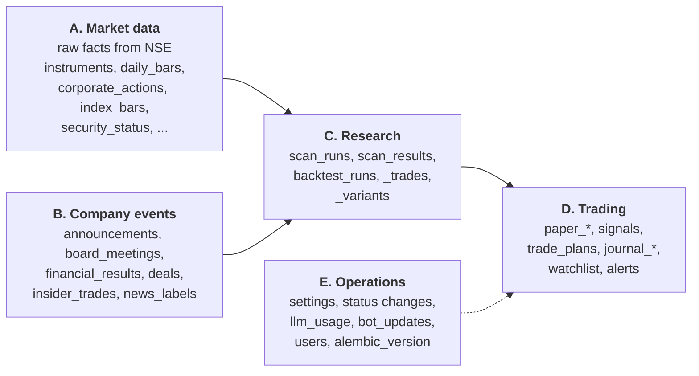
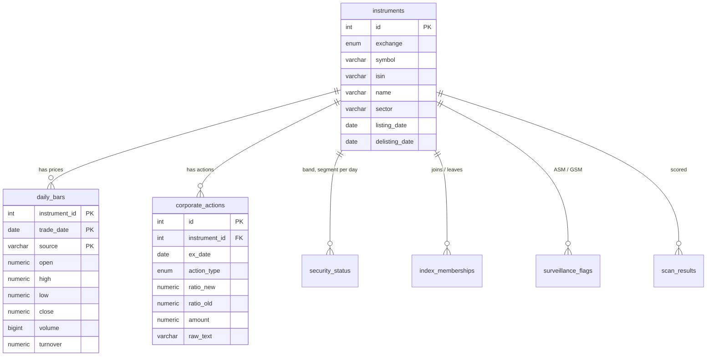
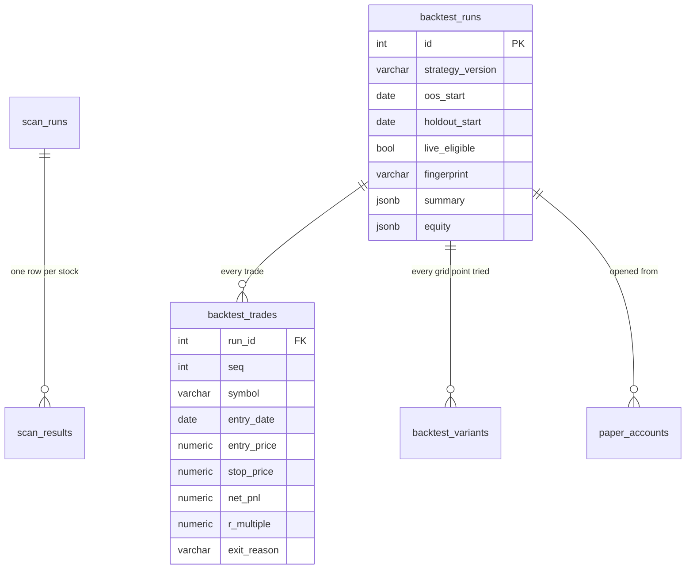
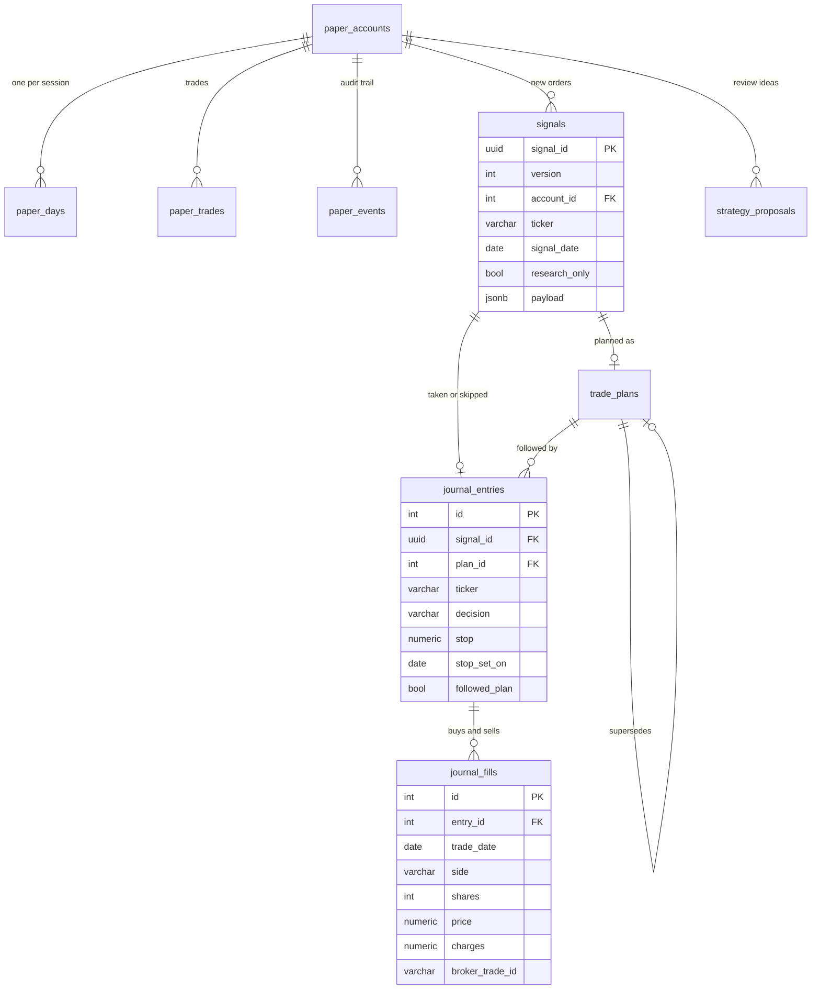
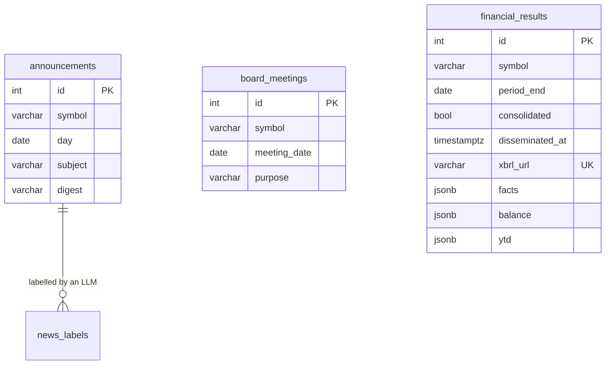
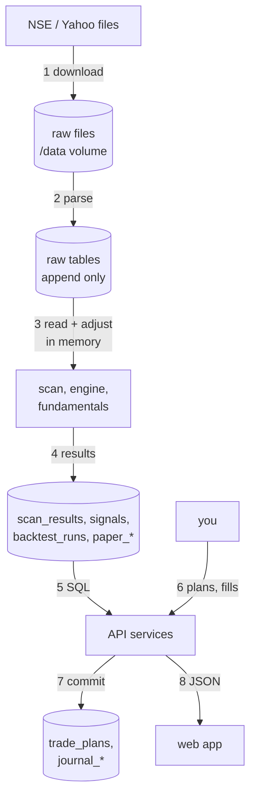

# About this part

This part explains Jeron's database: why PostgreSQL, the 40 tables in five groups, how
they relate (ER diagrams), the keys and indexes, the design choices and their
trade-offs, transactions and consistency, retention, backups and migrations, and exactly
how data moves between the app and the database.

Every table, column, key and index below was read from the live schema on 1 November
2026. Labels: **[EXISTS]**, **[PROPOSED]**, **[FUTURE]**.

---

# 1. Choosing the database

## 1.1 What Jeron needs from a database

1. **Exact money.** Prices and rupee amounts must never be rounded by floating point.
2. **Relations.** A fill belongs to a journal entry, which belongs to a signal, which
   belongs to a paper account, which came from a backtest run.
3. **Transactions.** Saving a plan, or a day of paper trading, must be all or nothing.
4. **Flexible documents** for some data: a backtest's summary has dozens of nested
   statistics; a signal's payload follows a schema that grows.
5. **Time series:** 5.4 million daily price rows, queried by stock and by date.
6. **One user, one machine, free.**

## 1.2 The choice: PostgreSQL 16 [EXISTS]

| Option | Fits? | Why |
|---|---|---|
| **PostgreSQL** | **Yes, chosen** | `NUMERIC` for exact money; full transactions; foreign keys; `JSONB` for documents in the same database; handles tens of millions of rows on a laptop; free |
| MySQL | Possible | Similar, but weaker JSON and fewer features Jeron uses (`NULLS NOT DISTINCT`, advisory locks, rich `ON CONFLICT`) |
| SQLite | Too small | One writer at a time; the API and the scheduler write concurrently |
| MongoDB | Poor fit | Relations and transactions are central here; documents are the minority |
| TimescaleDB | Later, maybe | A PostgreSQL extension for time series. The spec says add it only if queries get slow; they haven't |
| DuckDB / Parquet | For research, maybe | Very fast for backtest scans, but a second store to keep in sync |

**Why one database for both relational and document data?** `JSONB` gives the
flexibility of a document store where it's needed (backtest summaries, signal payloads,
fundamentals facts) without a second system to run, back up and keep consistent.

---

# 2. The 40 tables in five groups

| Group | Tables | Size | Changes |
|---|---|---|---|
| **A. Market data** | `instruments`, `daily_bars`, `corporate_actions`, `index_bars`, `index_memberships`, `security_status`, `surveillance_flags`, `symbol_changes`, `source_files`, `data_quality_reports` | about 1.73 GB | Daily, append only |
| **B. Company events** | `announcements`, `board_meetings`, `financial_results`, `deals`, `insider_trades`, `news_labels`, `news_batches`, `explanations` | about 580 MB | Daily, append only |
| **C. Research** | `scan_runs`, `scan_results`, `backtest_runs`, `backtest_trades`, `backtest_variants`, `strategy_proposals` | about 3.5 MB | Per run, never overwritten |
| **D. Trading** | `paper_accounts`, `paper_days`, `paper_trades`, `paper_events`, `signals`, `trade_plans`, `journal_entries`, `journal_fills`, `watchlist`, `alerts` | under 1 MB today | Daily and by you |
| **E. Operations** | `setting_changes`, `strategy_status_changes`, `llm_usage`, `bot_updates`, `users`, `alembic_version` | tiny | Occasionally |

The whole database is about **2.3 GB**, and 98% of it is groups A and B: raw market and
company data. Your own data (group D) is tiny but by far the most valuable, because it
can't be downloaded again.

---

# 3. ER diagrams

An **ER (entity-relationship) diagram** shows tables as boxes and how rows in one table
point to rows in another. `||--o{` reads "one to zero-or-many": one instrument has many
daily bars.

## 3.1 Market data

- `daily_bars` has a **composite primary key** `(instrument_id, trade_date, source)`:
  one row per stock, day and source. NSE and Yahoo rows sit side by side
  (`source = nse_bhavcopy` or `yahoo`), which is how the cross-check compares them.
- `corporate_actions` keeps NSE's original text (`raw_text`) next to the parsed ratio, so
  a parsing mistake can be found and fixed.
- `index_memberships` keeps join and leave dates, so the Nifty 500 of any past day can be
  rebuilt, **including stocks that were later delisted** (no survivorship bias).

## 3.2 Research

`backtest_runs.summary` is a `JSONB` document holding the gates, out-of-sample and holdout
statistics, results by year and regime, the confidence engine's output and the provenance
(code hash, settings hash, data fingerprint). It's read whole and never queried by its
parts in SQL, which is exactly when a document column beats twenty extra tables.

## 3.3 Trading: from backtest to your money

Reading the chain from left to right is reading Jeron's whole promise: a **backtest
run** opens a **paper account**; its new orders become **signals**; you make a **trade
plan**; your decision is a **journal entry**; your buys and sells are **fills**. Because
each link is a foreign key, any fill can be traced back to the backtest that justified it.

## 3.4 Company events, linked by symbol

These tables point to a stock by its **symbol text**, not by a foreign key to
`instruments`. Section 5.2 explains why, and the trade-off.

---

# 4. Keys, constraints and indexes

## 4.1 What they are

- **Primary key (PK):** the unique id of a row.
- **Foreign key (FK):** a column that must match another table's primary key. The
  database refuses a fill for a journal entry that doesn't exist.
- **Unique constraint:** no two rows may share these values. Jeron uses them to make
  every import idempotent.
- **Index:** a sorted lookup structure, like a book's index, so the database finds rows
  without reading the whole table. It speeds reads and slightly slows writes.

## 4.2 Jeron's 21 foreign keys [EXISTS]

`daily_bars`, `corporate_actions`, `security_status`, `surveillance_flags`,
`index_memberships` and `scan_results` reference `instruments`; `scan_results` references
`scan_runs`; `backtest_trades`, `backtest_variants` and `paper_accounts` reference
`backtest_runs`; `paper_days`, `paper_trades`, `paper_events`, `signals` and
`strategy_proposals` reference `paper_accounts`; `trade_plans` references `signals` and
itself (`supersedes_id`); `journal_entries` references `signals` and `trade_plans`;
`journal_fills` references `journal_entries`; `news_labels` references `announcements`.

## 4.3 Unique constraints that make imports safe [EXISTS]

| Table | Unique on | Prevents |
|---|---|---|
| `daily_bars` | `(instrument_id, trade_date, source)` | The same day's price twice |
| `corporate_actions` | `(instrument_id, source, ex_date, action_type, raw_text)` with `NULLS NOT DISTINCT` | The same action twice, even when a field is empty |
| `announcements` | `(symbol, day, digest)` | The same announcement twice (`digest` is a hash of the text) |
| `board_meetings` | `(symbol, meeting_date, purpose)` | |
| `financial_results` | `xbrl_url` | The same filing twice |
| `signals` | `(account_id, signal_date, ticker, version)` | A re-run duplicating signals |
| `journal_fills` | `broker_trade_id` | A tradebook imported twice |
| `alerts` | `key` | Sending the same alert twice |
| `news_labels` | `(announcement_id, labeller, prompt_version)` | Paying the LLM twice for one label |

`NULLS NOT DISTINCT` is a PostgreSQL 15+ feature: normally two `NULL`s count as
different, so a unique constraint wouldn't stop duplicates where a column is empty.

## 4.4 Indexes on the big tables [EXISTS]

| Table (rows) | Indexes | Serves |
|---|---|---|
| `daily_bars` (5.4 M + Yahoo) | PK `(instrument_id, trade_date, source)`; `trade_date` | One stock's history (PK prefix); one day across all stocks (`trade_date`) |
| `security_status` (3.6 M) | PK `(instrument_id, trade_date)`; `trade_date` | Same two patterns |
| `announcements` (906 k) | `symbol`; `day`; unique `(symbol, day, digest)` | A stock's news; a day's news |
| `board_meetings` (98 k) | `symbol`; `meeting_date` | Results dates per stock; blackout windows |
| `financial_results` (25 k) | `(symbol, period_end, consolidated)`; `xbrl_url` | A stock's quarters, point in time |
| `signals` | `account_id`; `signal_date` | An account's signals; a day's signals |
| `paper_trades`, `paper_days` | PK starting with `account_id` | An account's trades and days (a composite key's first column works as an index) |

**The rule behind them:** index the columns you filter by. Jeron reads market data in
two ways (one stock over time, or one day across all stocks), and the big tables have an
index for each.

## 4.5 Index gaps [PROPOSED]

1. `announcements (symbol, day DESC)` as one composite index. The stock page asks for
   "this stock's latest 40 announcements"; today PostgreSQL uses the `symbol` index and
   then sorts. A composite index returns them already in order.
2. Check before adding anything: run `EXPLAIN ANALYZE` on the slow query first. An index
   that no query uses only costs write time and disk.

---

# 5. Design decisions and their trade-offs

## 5.1 Raw data is never changed [EXISTS]

Prices are stored exactly as NSE published them. Adjusted prices (for splits, bonuses,
rights and demergers) are computed **on read** from `corporate_actions` (decision 0003).

- **Good:** an adjustment bug can be fixed and every result re-computed; the original
  facts are never lost; the spot-check page can show raw and adjusted side by side.
- **Cost:** every read applies the factors. Measured: building the backtest market for
  2,930 stocks x 2,683 days takes about 3 minutes, which is acceptable.
- **Bad alternative:** overwriting old prices after a split. One wrong ratio then
  corrupts history permanently, with no way to know.

## 5.2 Company events keyed by symbol, not instrument id [EXISTS]

`announcements`, `board_meetings`, `financial_results`, `deals` and `insider_trades`
store a symbol string.

- **Why:** these come from different NSE files, sometimes for companies Jeron has no
  price row for yet (new listings, SME, debt-only). Requiring a matching `instruments` row
  would drop real data or force placeholder rows.
- **Cost:** no foreign key, so the database can't stop a typo, and a renamed company has
  rows under two symbols. Jeron handles renames with `symbol_changes` (1,069 recorded),
  joined when reading.
- **[PROPOSED]** A nullable `instrument_id` column filled when the symbol matches, kept
  alongside the text. Joins become exact while unmatched rows are still kept.

## 5.3 Point in time [EXISTS]

Every fact that can change keeps the time it became known: `financial_results.disseminated_at`
(and each revision is its own row), `index_memberships` join and leave dates,
`instruments.delisting_date`, `stop_set_on` on journal entries. Queries ask "as known
at time T" (`quarters_known(session, symbols, as_of)`), never "latest".

**Common mistake:** storing only the latest value ("current P/E", "current index
members"). A backtest then uses information that didn't exist yet, and looks far better
than reality.

## 5.4 Append-only history [EXISTS]

Rows in `backtest_runs`, `signals`, `trade_plans`, `paper_events`,
`strategy_status_changes` and `setting_changes` are never updated or deleted. A change
is a new row (a signal gets a new `version`; a plan points to the one it `supersedes`;
the kill switch is a new `setting_changes` row). History explains itself, and nothing
can be quietly rewritten after a bad result.

## 5.5 Normalisation and where Jeron deliberately breaks it

**Normalisation** means storing each fact once and referring to it, so it can't disagree
with itself. Jeron is normalised where facts change (prices, fills, plans) and
deliberately *denormalised* where data is a snapshot:

| Denormalised data | Why it's right here |
|---|---|
| `signals.payload` (JSONB, the full signal) | A signal is immutable; it must show exactly what was sent, even if a strategy's rules change later |
| `backtest_runs.summary` and `equity` | A frozen report of one run |
| `trade_plans.details` | The plan as calculated at that moment |
| `financial_results.facts`, `balance`, `ytd` | Every XBRL fact, kept for later use without new columns |

## 5.6 Money and time types [EXISTS]

- Money and prices: `NUMERIC` in the database, `Decimal` in Python, strings in JSON.
  Floats are used only inside the backtester's arrays (where speed matters and the result
  is reported, not stored as money).
- Timestamps: `timestamptz` (stored in UTC, shown in IST). Market logic uses IST dates.

---

# 6. Transactions and consistency

A **transaction** groups changes so they all happen or none do.

| Operation | Transaction scope [EXISTS] |
|---|---|
| An API write (save a plan, add a fill) | One session per request, one commit at the end |
| A day of paper trading | The account's day, trades, signals and events committed together |
| Bulk imports (prices, filings) | Committed in batches; each batch is consistent, and re-running skips what's stored |

**Isolation:** PostgreSQL's default, *read committed*, is used. A page may read while the
daily job writes and will see either the old day or the new one, never half a row.
**[PROPOSED]** The daily job writes the scan, signals and alerts in separate commits; a
reader at the wrong second can see new prices but yesterday's scan. A `job_runs` row
(Part 2) marking "day complete" lets pages show "updating" until it's done.

---

# 7. How data moves

1. Jobs download NSE's files to the `/data` volume first (kept, so a re-parse needs no
   download; the XBRL re-parse in fundamentals v2 used this).
2. Parsers turn files into rows in the raw tables.
3. Calculations read raw rows and adjust them in memory; adjusted prices are never
   stored.
4. Results (scores, signals, runs) are stored.
5. The API reads results with SQL.
6. and 7. Your plans and fills are written in one transaction each.
8. The web app receives JSON.

There's **no cache layer** between the API and PostgreSQL today (Part 2, section 5.8).

---

# 8. Query performance

| Concern | Today | When to act |
|---|---|---|
| Daily scan | 21.7 s for 3,004 stocks (spec limit: 5 minutes) | No action |
| Backtest market build | About 3 minutes (reads 5.4 M rows) | If backtests become frequent: cache the built arrays to disk (Parquet or `.npz`) keyed by the data fingerprint, so repeated backtests skip the rebuild [PROPOSED] |
| `daily_bars` growth | About 2,000 rows a day: about 0.5 M a year | Fine for decades on PostgreSQL |
| `security_status` growth | About 2,000 rows a day | Same |
| N+1 queries | `_closes()` in the fundamentals page runs one query per date (up to 21) | [PROPOSED] one query with `trade_date = ANY(...)`. Small win, simple fix |

**N+1** means running one query, then one more query per row of its result. It's the most
common database performance mistake in web apps.

**Partitioning** (splitting a table into one physical piece per year) is **not needed**:
it helps at hundreds of millions of rows or when old data must be dropped quickly. Jeron
has neither.

---

# 9. Retention

| Data | Policy today | Recommendation |
|---|---|---|
| Market and company data | Kept forever | Keep: backtests need full history |
| Your journal, plans, signals, paper | Kept forever | Keep: it's the most valuable data |
| Backtest runs | Kept forever (about 70 KB each) | Keep: the record of every trial is part of the overfitting guard |
| Raw downloaded files (`/data`, about 2.5 GB) | Kept forever | [PROPOSED] keep: they make re-parsing possible without hitting NSE |
| Backups | Newest 14 kept | [PROPOSED] add 1 monthly backup kept for 12 months, so a problem found weeks later can still be undone |
| Logs | Docker's default | [PROPOSED] rotate (Docker `max-size` and `max-file`) so they can't fill the disk |

---

# 10. Backup and recovery [EXISTS]

1. **Nightly** after 02:00 IST, the `backup` container runs `pg_dump` in custom format to
   `backups/jeron-YYYY-MM-DD.dump`.
2. The dump is **kept only if `pg_restore` can read it**. A backup you can't restore is
   worse than none, because it gives false comfort.
3. The **newest 14** are kept. Set `JERON_BACKUP_DIR` to a synced folder (Google Drive)
   for an off-machine copy.
4. **Weekly**, the newest dump is restored into a scratch database (`backup.sh verify`),
   and the result is written to `restore-check.txt`, which Setup and the pre-open check
   show.
5. `docs/runbook.md` has the quarterly restore drill.

**Recovery objectives** in plain words:

- **RPO** (recovery point objective: how much data you could lose): up to 24 hours, since
  the last nightly dump. For a tool updated once a day, that's at most one day's journal
  entries.
- **RTO** (recovery time objective: how long to get back): about 15 minutes. Restore the
  latest dump (`pg_restore`), start the containers, and the autopilot catches up the
  missing days.

**[PROPOSED]** Encrypt off-machine copies (`age` or `gpg`) before they reach a cloud
folder: the dump contains your positions.

---

# 11. Migrations

A **migration** is a versioned script that changes the database's structure (add a
table, add a column). Jeron uses **Alembic** with 21 migrations [EXISTS].

1. Change `app/models.py`.
2. `uv run alembic revision --autogenerate -m "..."` writes a draft migration by
   comparing the models with the database.
3. **Review the draft by hand.** Autogenerate misses some things (renames look like a
   drop and an add) and gets defaults wrong.
4. Add a `server_default` for new non-null columns, so existing rows get a value (the
   fundamentals v2 migration did this: `balance` and `ytd` default to `{}`).
5. Test both directions: `alembic upgrade head` and `alembic downgrade -1`.
6. The backend runs `alembic upgrade head` when it starts.

**Common mistakes:** dropping a column in the same release that stops using it (deploy
the code first, drop later); a long-running data change inside a migration (do it as a
separate job, as `fundamentals-reparse` does).

---

# 12. Summary of Part 3's proposals

| # | Proposal | Why | Size |
|---|---|---|---|
| D1 | Composite index `announcements (symbol, day DESC)` | Faster stock pages | Small |
| D2 | Nullable `instrument_id` on symbol-keyed event tables | Exact joins, renames handled once | Medium |
| D3 | One query instead of N in the fundamentals price lookup | Fewer round trips | Small |
| D4 | Cache the built backtest market to disk by fingerprint | Repeated backtests skip a 3-minute build | Medium |
| D5 | Monthly backups kept 12 months; encrypt off-machine copies | Recover from late-found problems; privacy | Small |
| D6 | Docker log rotation | Disk can't fill | Small |
| D7 | A "day complete" marker readers can check | No half-updated pages during the daily job | Small |

**Part 4** covers security and reliability, infrastructure and deployment, and how
Jeron would behave and change at 1,000, 10,000, 100,000 and 1 million users.
