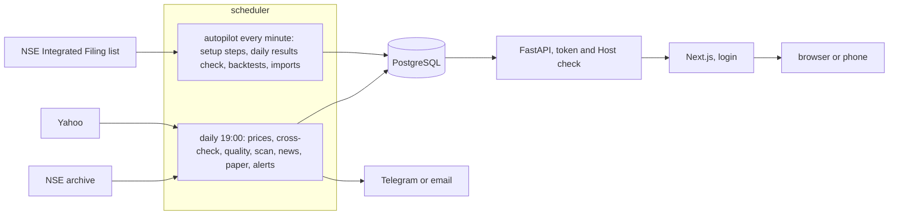

# Platform review v5 (2026-11-21)

An audit of `main` at `c5a4008` (PR #56) plus the paper-coverage change, asked for by
Abhishek ("transform the existing application into the best possible version"). Three
earlier reviews (`platform-audit-v1`, `platform-review-v3`, `v4`) covered security, risk
rules and the code's structure from reading it. This one ran the application: every
check, every page in a browser, and the whole nightly pipeline on live NSE data.

## What ran

| Check | Before | After |
|---|---|---|
| Backend tests (`pytest`, with PostgreSQL 16) | 780 passed | 785 passed |
| `ruff check`, `ruff format --check`, `mypy app` (strict) | clean | clean |
| Web `lint`, `typecheck`, `npm test`, `build` | clean, 26 tests | clean, 28 tests |
| `pip-audit` as CI runs it | **1 vulnerability** | none |
| `npm audit` | **7 advisories in next 16.4.2**, 1 dev-only | 0 |
| Every page in Chromium, desktop and phone (32 addresses each) | 200 everywhere; missing items answered 200 | missing items 404 |
| Every page on an empty, migrated database (a fresh install) | | 20 pages 200, 4 missing 404 |
| `scan`, `backtest` of all 19 strategies and combined-book, `paper` on the research database (NSE 2016 to 2026-11-09) | | all ran; 19 paper accounts |
| `daily` against live NSE (9 sessions to 2026-11-20) | | ran end to end, 13m 22s |
| `daily` again for the same session | | 9m 55s, no duplicate signals or positions |

Not run here: `docker compose` (no Docker in the cloud container; CI runs it), the
owner's own database, Telegram or email delivery (no credentials).

## Findings and what was done

| # | Area | Finding (evidence) | Outcome |
|---|---|---|---|
| 1 | Security | `opentelemetry-api` 1.45.1, pulled in by FastAPI, has CVE-2026-126360; CI's audit step would fail | Upgraded to 1.45.2 |
| 2 | Security | `next` 16.4.2 has seven advisories (cache disclosure, response injection on self-hosted servers, SVG bypass, others) | `next` and `eslint-config-next` to 16.4.6; in-range audit fix for the lint tooling |
| 3 | Product | Quarterly results stay current only if the owner runs `fundamentals-fetch` by hand. `value-trend-v1`, the best-supported strategy, then goes to cash 200 days after the newest quarter | The autopilot checks NSE daily (merged with PR #57's design: 200 days back, or from the newest stored quarter if older), retries the next day on failure, and re-backtests both results strategies when filings arrive (`fundamentals-fetch-v1.md`) |
| 4 | Correctness | New results re-backtested `quality-trend` but not `value-trend`, which reads the same filings | Both, through `RESULTS_STRATEGIES` |
| 5 | Security | An uploaded zip could unpack to any size; an oversized upload was read into memory before the size check | Unpacking stops at 2 GB counted as written, and removes what it wrote; uploads are refused on their declared length first |
| 6 | UX | A missing stock, backtest, paper account or journal entry showed a bare line with no way back, and answered 200 | A 404 from the API shows a not-found page with links back, and answers 404 |
| 7 | UX | Today's setup banner read "told when jeron is off", "api token" (whole titles lower-cased) | `listInSentence` lowers only the first letter, keeps names and acronyms, tested |
| 8 | UX | The stock chart printed the price pane's lowest label over the index pane's highest | `entireTextOnly` on the price scale |
| 9 | Reliability | CI opened three pages; a page that crashes on a fresh install would pass | CI opens every page found in `web/src/app` and checks four 404s |
| 10 | Operations | The daily log said nothing about time; a slow evening couldn't be read from it | A closing line with each step's time |

The fixes are in five commits on `claude/eloquent-mayer-vpvuko`, each with its tests.

## Observed on real data, for the owner

- **`sector-rotation-v1` passed all seven checks** on this database (266 trades, 0.27R,
  profit factor 1.50), though CLAUDE.md records it as research only from earlier runs.
  Its paper account opened as live-eligible here. Whether it paper-trades with alerts is
  the owner's decision; nothing was changed. `rs-pullback-v1` failed its holdout here
  (-0.012R), as in `residual-momentum-v1-report.md`.
- **The nightly run's time is the Yahoo cross-check**: about 1,050 stocks, one request
  each at the configured 0.5 s, about 9 minutes. Everything else took under a minute.
  Well inside the 45 minutes before the watchdog's alarm, so left as it is.
- **A full market build takes about 4 minutes** (103 s loading and adjusting prices in
  exact `Decimal` arithmetic, 104 s of per-stock indicators in Python loops). It is paid
  by each backtest run, not by the nightly run (paper took 44 s).

## Not built, and why

1. **A faster market build.** Running stocks in parallel processes would cut it to
   about a minute on four cores with identical numbers, but adds memory and process
   handling to the scheduler container for a cost paid only by occasional backtests.
   Vectorising the indicators could change floating-point results that the TA-Lib
   reference tests and golden trades pin; recursive ones (EMA, Wilder) can't be.
2. **A faster cross-check.** Yahoo's batch endpoints don't return split and dividend
   events, which the cross-check uses to recognise Yahoo's scaling; faster pacing
   risks Yahoo's rate limits, seen in this session.
3. **Splitting `app/cli.py`** (one long dispatcher). It works and is tested through
   every command; moving it would be churn without a defect behind it.
4. **New features.** The ones that change what is traded (new strategies, statuses,
   risk limits) are the owner's to ask for under the spec's rules. The ones found here
   were defects or gaps, and are fixed above.

## Where the rest lives

- Setup and running: `README.md`. Architecture: `docs/architecture/part-1` to `part-3`
  (part 3 is the database). API: FastAPI's own `/docs` and `/openapi.json` on the
  backend. Incidents: `docs/runbook.md`. Checking an install:
  `docs/prompts/verify-strategies.md`.

